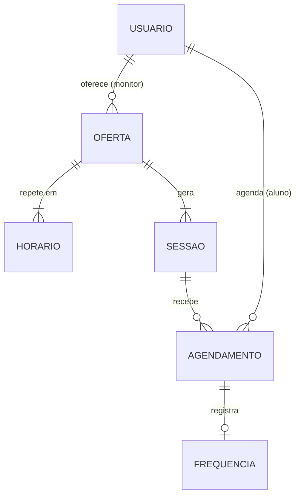
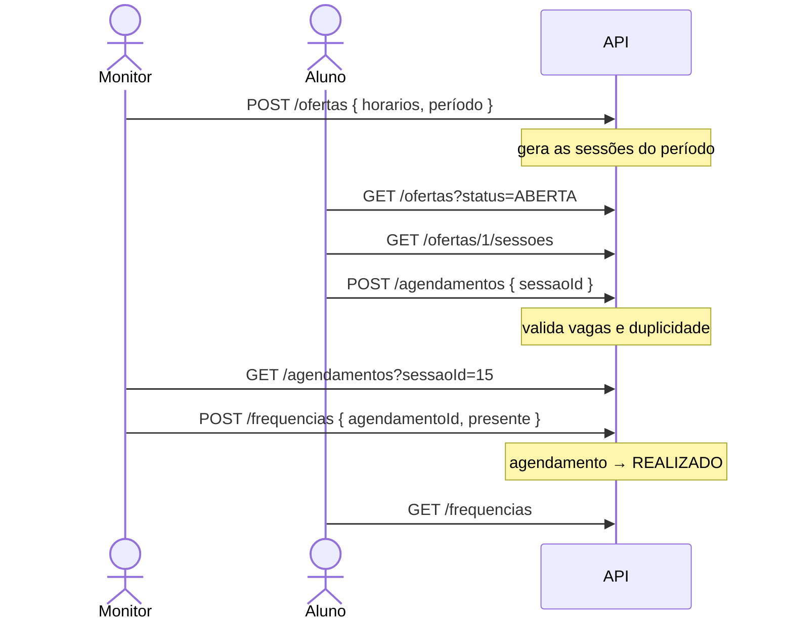

# Contrato da API

**Status:** aprovado pela equipe.

Contrato entre frontend e backend. Qualquer mudança aqui deve ser combinada com a
equipe e feita no mesmo PR que altera a implementação.

Decisões relacionadas:
[ADR-0002 — Persistência](adr/0002-persistencia-sqlite-prisma.md) ·
[ADR-0003 — Identificação](adr/0003-identificacao-simplificada.md) ·
[ADR-0004 — Ofertas recorrentes e sessões](adr/0004-ofertas-recorrentes-e-sessoes.md)

## Convenções gerais

- Base local: `http://localhost:3000`
- Corpo das requisições e respostas em **JSON**.
- Datas e horas completas em **ISO 8601 UTC** (`2026-11-24T17:00:00.000Z`).
- Datas sem hora em `AAAA-MM-DD`; horas semanais em `HH:mm`, no fuso **America/Sao_Paulo**.
- IDs são inteiros.
- Rotas que dependem do usuário exigem o cabeçalho **`X-Usuario-Id`** (ver ADR-0003).
  Na tabela de cada rota, a coluna **Quem** indica quem pode chamar; `—` significa que é pública.
- Não há rotas `DELETE`: ofertas são **encerradas** e sessões e agendamentos são **cancelados**.

### Erros

Todas as respostas de erro seguem o formato:

```json
{ "erro": { "codigo": "SESSAO_SEM_VAGAS", "mensagem": "Não há vagas disponíveis nesta sessão." } }
```

| Status | Quando |
|---|---|
| `400` | Corpo ou parâmetros inválidos (campo faltando, tipo errado) |
| `401` | `X-Usuario-Id` ausente ou de usuário inexistente |
| `403` | Usuário não tem o papel ou a permissão para a operação |
| `404` | Recurso não encontrado |
| `409` | Violação de regra de negócio (sem vagas, agendamento duplicado etc.) |

## Modelo de dados



### Usuario

| Campo | Tipo | Observação |
|---|---|---|
| `id` | int | |
| `nome` | string | |
| `email` | string | único |
| `papel` | `ALUNO` \| `MONITOR` | |

### Oferta

A monitoria recorrente de uma disciplina.

| Campo | Tipo | Observação |
|---|---|---|
| `id` | int | |
| `disciplina` | string | ex.: `"Algoritmos e Estruturas de Dados I"` |
| `codigoDisciplina` | string | ex.: `"GCC216"` |
| `descricao` | string? | opcional |
| `local` | string | sala ou link |
| `vagas` | int | vagas **por sessão**, ≥ 1 |
| `dataInicio` | date | primeiro dia do período |
| `dataFim` | date | último dia; no máximo 6 meses após `dataInicio` |
| `horarios` | `Horario[]` | ao menos um |
| `status` | `ABERTA` \| `ENCERRADA` | |
| `monitor` | `{ id, nome }` | |

### Horario

| Campo | Tipo | Observação |
|---|---|---|
| `diaSemana` | `SEG` \| `TER` \| `QUA` \| `QUI` \| `SEX` \| `SAB` | |
| `horaInicio` | `HH:mm` | |
| `horaFim` | `HH:mm` | depois de `horaInicio` |

### Sessao

Uma ocorrência concreta da oferta, gerada automaticamente.

| Campo | Tipo | Observação |
|---|---|---|
| `id` | int | |
| `ofertaId` | int | |
| `inicio` | datetime | |
| `fim` | datetime | |
| `vagas` | int | copiado da oferta |
| `vagasDisponiveis` | int | **calculado**: `vagas` − agendamentos com status `AGENDADO` |
| `status` | `PREVISTA` \| `CANCELADA` | |

### Agendamento

| Campo | Tipo | Observação |
|---|---|---|
| `id` | int | |
| `sessaoId` | int | |
| `alunoId` | int | |
| `status` | `AGENDADO` \| `CANCELADO` \| `REALIZADO` | |
| `criadoEm` | datetime | |

### Frequencia

| Campo | Tipo | Observação |
|---|---|---|
| `id` | int | |
| `agendamentoId` | int | único (uma frequência por agendamento) |
| `presente` | boolean | |
| `observacao` | string? | opcional |
| `registradoEm` | datetime | |

## Visibilidade dos agendados

Quem pode ver quem está agendado numa sessão:

| Quem | O que vê | Por qual rota |
|---|---|---|
| Monitor dono da oferta | A lista completa: agendamentos com status e dados do aluno | `GET /agendamentos?sessaoId=` (só das ofertas dele) e `GET /sessoes/:id` |
| Aluno (qualquer um, mesmo sem estar agendado) | Só os nomes de quem está agendado | `GET /sessoes/:id` |
| Outro monitor (de outra oferta) | Só os nomes | `GET /sessoes/:id` |
| Sem identificação (sem `X-Usuario-Id`) | Ninguém, só a quantidade de vagas | `GET /ofertas/:id/sessoes` |

## Endpoints

### Saúde

| Método | Rota | Quem | Descrição |
|---|---|---|---|
| `GET` | `/health` | — | Verifica se a API está no ar |

### Usuários

| Método | Rota | Quem | Descrição |
|---|---|---|---|
| `POST` | `/usuarios` | — | Cadastra usuário |
| `GET` | `/usuarios` | — | Lista usuários (`?papel=MONITOR`), usado na tela "entrar como" |
| `GET` | `/usuarios/:id` | — | Detalha um usuário |

`POST /usuarios`

```json
{ "nome": "Ana Souza", "email": "ana@estudante.ufla.br", "papel": "ALUNO" }
```

→ `201` com o usuário criado · `409 EMAIL_JA_CADASTRADO`

### Ofertas

| Método | Rota | Quem | Descrição |
|---|---|---|---|
| `GET` | `/ofertas` | — | Lista ofertas. Filtros: `?status=ABERTA`, `?codigoDisciplina=GCC216`, `?monitorId=2` |
| `GET` | `/ofertas/:id` | — | Detalha uma oferta, com horários e a próxima sessão prevista |
| `GET` | `/ofertas/:id/sessoes` | — | Lista as sessões com `vagasDisponiveis`, sem nomes. Padrão: só futuras; `?desde=AAAA-MM-DD` muda o início |
| `POST` | `/ofertas` | MONITOR | Cria a oferta e gera as sessões; o monitor é o usuário do cabeçalho |
| `PATCH` | `/ofertas/:id` | MONITOR dono | Altera `descricao`, `local` ou `vagas`, ou encerra (`{ "status": "ENCERRADA" }`) |

`POST /ofertas`

```json
{
  "disciplina": "Algoritmos e Estruturas de Dados I",
  "codigoDisciplina": "GCC216",
  "descricao": "Monitoria semanal de AED I",
  "local": "DCC - Sala 105",
  "vagas": 10,
  "dataInicio": "2026-11-23",
  "dataFim": "2027-03-20",
  "horarios": [
    { "diaSemana": "TER", "horaInicio": "14:00", "horaFim": "16:00" },
    { "diaSemana": "QUI", "horaInicio": "14:00", "horaFim": "16:00" }
  ]
}
```

→ `201` com a oferta criada e `totalSessoes` gerado

Regras:
- `dataFim` ≥ `dataInicio`, período de até 6 meses e `dataInicio` não pode estar no passado (`400`).
- Ao menos um horário; `horaFim` depois de `horaInicio`; sem horários sobrepostos no mesmo dia (`400`).
- O período precisa gerar ao menos uma sessão (`400 PERIODO_SEM_SESSOES`).
- Os horários semanais e o período **não podem ser alterados**: encerre e crie outra oferta.
- Alterar `local` ou `vagas` vale só para as sessões futuras `PREVISTA`. `vagas` não pode
  ficar menor que os agendamentos ativos de nenhuma delas (`409 VAGAS_INSUFICIENTES`).
- **Encerrar** é irreversível: as sessões futuras viram `CANCELADA` e os agendamentos
  `AGENDADO` delas viram `CANCELADO`. Sessões passadas e frequências são mantidas.
- Só o monitor que criou a oferta pode alterá-la (`403`). Oferta encerrada não aceita alteração (`409`).

### Sessões

| Método | Rota | Quem | Descrição |
|---|---|---|---|
| `GET` | `/sessoes/:id` | Qualquer usuário identificado | Detalha a sessão. Monitor dono: agendamentos completos. Demais: só os nomes dos agendados |
| `PATCH` | `/sessoes/:id/cancelar` | MONITOR dono | Cancela uma sessão específica (ex.: feriado) |

`GET /sessoes/:id`, visto pelo monitor dono:

```json
{
  "id": 15, "ofertaId": 1, "inicio": "2026-11-24T17:00:00.000Z", "fim": "2026-11-24T19:00:00.000Z",
  "vagas": 10, "vagasDisponiveis": 8, "status": "PREVISTA",
  "agendamentos": [
    { "id": 7, "status": "AGENDADO", "aluno": { "id": 3, "nome": "Ana Souza", "email": "ana@estudante.ufla.br" } },
    { "id": 9, "status": "AGENDADO", "aluno": { "id": 4, "nome": "Bruno Lima", "email": "bruno@estudante.ufla.br" } }
  ]
}
```

Visto por qualquer outro usuário identificado:

```json
{
  "id": 15, "ofertaId": 1, "inicio": "2026-11-24T17:00:00.000Z", "fim": "2026-11-24T19:00:00.000Z",
  "vagas": 10, "vagasDisponiveis": 8, "status": "PREVISTA",
  "agendados": ["Ana Souza", "Bruno Lima"]
}
```

Regras:
- Sem `X-Usuario-Id`: `401`. Para ver só as vagas, use `GET /ofertas/:id/sessoes`.
- Para quem não é o monitor dono, a lista `agendados` traz só os agendamentos com status `AGENDADO`.
- Cancelar só é permitido com a sessão `PREVISTA` e antes do `inicio` (`409`).
  Os agendamentos `AGENDADO` dela viram `CANCELADO`.

### Agendamentos

| Método | Rota | Quem | Descrição |
|---|---|---|---|
| `POST` | `/agendamentos` | ALUNO | Agenda o aluno do cabeçalho numa sessão |
| `GET` | `/agendamentos` | ALUNO / MONITOR | Aluno: os seus, com dados da sessão e da oferta. Monitor: exige `?sessaoId=` de uma oferta sua |
| `PATCH` | `/agendamentos/:id/cancelar` | ALUNO dono | Cancela o agendamento |

`POST /agendamentos`

```json
{ "sessaoId": 15 }
```

→ `201` com o agendamento criado

Regras:
- A sessão precisa existir (`404`), estar `PREVISTA`, pertencer a uma oferta `ABERTA` e
  não ter começado (`409 SESSAO_INDISPONIVEL`).
- Precisa ter vaga (`409 SESSAO_SEM_VAGAS`).
- O aluno não pode ter outro agendamento `AGENDADO` na mesma sessão (`409 AGENDAMENTO_DUPLICADO`).
- Monitor consultando sessão de oferta que não é dele: `403`.
- Cancelar só é permitido com status `AGENDADO` e antes do `inicio` da sessão (`409`).
  O cancelamento libera a vaga.

### Frequências

| Método | Rota | Quem | Descrição |
|---|---|---|---|
| `POST` | `/frequencias` | MONITOR dono da oferta | Registra presença ou falta de um agendamento |
| `GET` | `/frequencias` | ALUNO / MONITOR | Aluno: o seu histórico. Monitor: `?sessaoId=` ou `?ofertaId=` de uma oferta sua |

`POST /frequencias`

```json
{ "agendamentoId": 7, "presente": true, "observacao": "Tirou dúvidas sobre árvores AVL" }
```

→ `201` com a frequência criada

Regras:
- Só o monitor da oferta do agendamento pode registrar (`403`).
- Só depois do `inicio` da sessão (`409 SESSAO_NAO_INICIADA`).
- O agendamento precisa estar `AGENDADO` (`409`); ao registrar, passa para `REALIZADO`.
- Uma frequência por agendamento (`409 FREQUENCIA_JA_REGISTRADA`).

## Fluxo principal (transação entre contextos)


